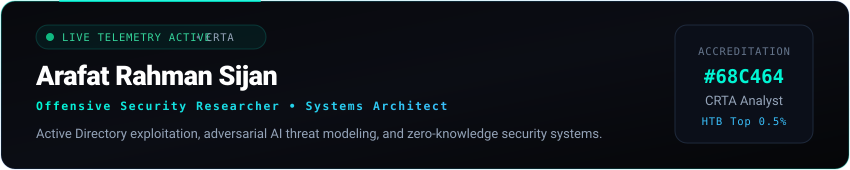
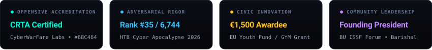

 

 

 

  
  &nbsp;
  
  &nbsp;
  
  &nbsp;
  

---

### 🛡️ About Me

I am an **Offensive Security Researcher** and **Certified Red Team Analyst (CRTA #68C464)** with an academic foundation in Computer Science & Engineering at the University of Barishal. My focus lies in adversary emulation across enterprise Windows Active Directory forests, stress-testing Large Language Models against indirect prompt injections, and engineering zero-knowledge threat containment systems.

Founding President of **BU ISSF** (*Intelligent Systems & Security Forum*) and recipient of the **€1,500 EU Youth Empowerment Fund / Global Youth Mobilization** grant for civic digital defense initiatives.

---

### ⚔️ Core Technical Vectors

* **Red Teaming & Active Directory:** Kerberos Unconstrained Delegation abuse, Kerberoasting, AS-REP Roasting, DCSync replication, BloodHound attack-path graph heuristics, and multi-hop network pivoting (Ligolo-ng).
* **Adversarial AI Threat Defense:** LLM threat modeling, indirect prompt injection execution, automated jailbreak payloads, boundary evaluation, and zero-knowledge telemetry scrapers.
* **Precision OSINT & Reconnaissance:** Threat-actor infrastructure correlation, chronolocation, passive DNS forensics, satellite imagery metadata extraction, and operational sock-puppet hygiene.
* **Defensive Engineering & SIEM:** Splunk Enterprise log engineering (`XmlWinEventLog:OpenSSH`), custom SPL analytics, K-Anonymity credential verification, and honeytoken canary alerting.

---

### 🔬 Featured Repositories

| Repository | Focus & Architecture | Verifiable Proof |
| :--- | :--- | :--- |
| **[CryptaLeak](https://github.com/AR-Sijan/CryptaLeak)** | **Zero-Knowledge Breach Detection Engine** Java 21 LTS + MySQL 8.4. SHA-256 K-Anonymity (5-char prefix bucketing), AES-256 E2EE, in-memory BFS lateral traversal graph, and canary honeytoken alerting. | [Repository](https://github.com/AR-Sijan/CryptaLeak) • [Dossier](https://portfolio-mocha-beta-56.vercel.app/) |
| **[ad-attack-defense](https://github.com/AR-Sijan/ad-attack-defense)** | **Active Directory Attack & Defense Field Guide** Kerberos unconstrained delegation abuse, DCSync privilege escalation, BloodHound cypher heuristics, and production Splunk SPL detection rules. | [CRTA #68C464](https://portfolio-mocha-beta-56.vercel.app/writeups/ad-kerberos-delegation) |
| **[htb-cyber-apocalypse-2026](https://github.com/AR-Sijan/htb-cyber-apocalypse-2026)** | **HTB Cyber Apocalypse 2026: 100% Solve Speedrun** Technical methodologies from solving 136/136 challenges (69,425 pts) placing **#35 globally out of 6,744 international teams** (glibc 2.38 safe-linking, lattice crypto, OSINT). | [HTB Global #35](https://portfolio-mocha-beta-56.vercel.app/writeups/htb-apocalypse-2026) |
| **[Purple-Team-SSH-Lab](https://github.com/AR-Sijan/Purple-Team-SSH-Lab)** | **Purple Team SSH Brute Force SIEM Homelab** Kali Linux (Hydra) attack simulation detected in real time on Windows 10 through Splunk Enterprise & Universal Forwarder log engineering. | [YouTube Walkthrough](https://www.youtube.com/watch?v=Y8wrNAIpDtA) |
| **[gosh09](https://github.com/AR-Sijan/gosh09)** | **Go-Based Interactive WebSocket Reverse Operator** Lightweight, statically compiled Windows PE operator agent communicating over encrypted WebSockets for firewall-traversing interactive command sessions. | [Source Code](https://github.com/AR-Sijan/gosh09) |
| **[portfolio](https://github.com/AR-Sijan/portfolio)** | **Tactical Cybersecurity Command Center** Next.js 14 SSG, Obsidian dark cyber aesthetic, HSTS (`max-age=63072000`), strict CSP, interactive terminal shell, and CTF challenge headers. | [Live Site](https://portfolio-mocha-beta-56.vercel.app/) |

---

### 🧩 CTF Challenge for Security Researchers

> Check the HTTP response headers of [portfolio-mocha-beta-56.vercel.app](https://portfolio-mocha-beta-56.vercel.app/) for `X-Cyber-Challenge`.  
> Or open the site's web terminal (`~` or `Ctrl+K`) and execute `submit-flag <flag>`.

---

  Arafat Rahman Sijan • Certified Red Team Analyst (CRTA #68C464) • All research conducted in authorized scopes.

